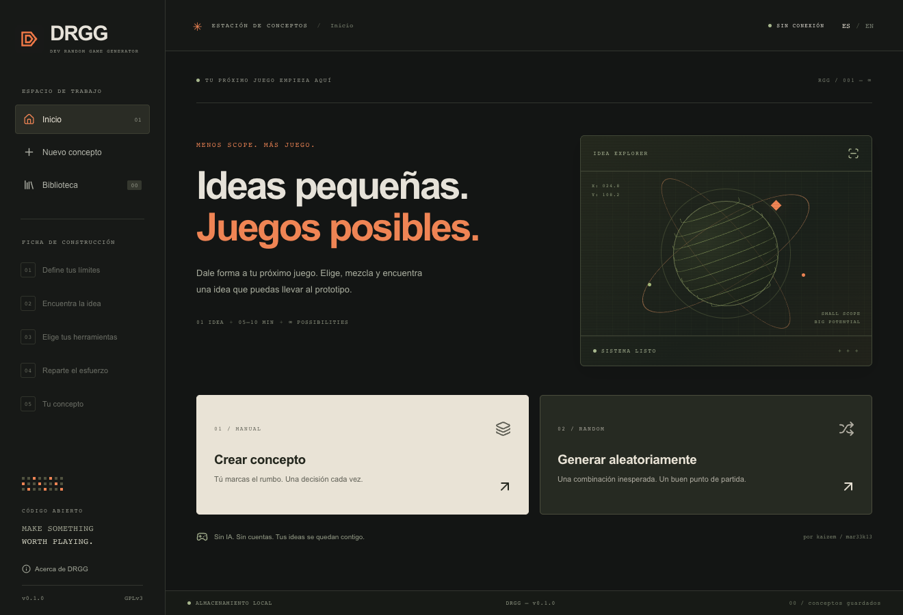

# DRGG — DevRandomGameGenerator

**Ideas pequeñas. Juegos posibles. / Small ideas. Possible games.**

App de escritorio para decidir qué videojuego pequeño construir en 5–10 minutos. Creada por **kaizem (mar33k13)**. Sin IA, cuentas, telemetría, suscripciones ni servicios externos.



## Usar DRGG

Los instaladores publicados estarán en [GitHub Releases](https://github.com/mar33k13/DRGG/releases). Antes de publicar una versión, los paquetes de prueba se descargan como artifacts desde GitHub Actions. No necesitas Node ni Rust para usar un instalador.

1. Elige **Crear concepto** o **Generar aleatoriamente**.
2. Define el equipo real y objetivo: microjuego, prototipo o juego pequeño.
3. Combina tema, género, subgénero, motor, plataforma, dimensionalidad, perspectiva, estilo y modo de juego.
4. Reparte **100 puntos** entre mecánicas, físicas, gráficos, narrativa y audio.
5. Obtén una ficha con tres mecánicas, recortes de alcance, complejidad y equipo orientativo. Ponle nombre y guárdala.

Bloquea cualquier selector para conservarlo al sortear. Equipo y objetivo empiezan bloqueados. El modo **coherente** ajusta selecciones relacionadas respetando los bloqueos; si no existe solución, avisa sin modificarlos. El modo **libre** admite mezclas incompatibles y las señala. El exceso de alcance se advierte, sin bloquear. Las reglas son una selección práctica, no todas las posibilidades técnicas de cada motor.

La biblioteca permite abrir, editar, duplicar y eliminar conceptos. Exporta Markdown, texto o JSON; importa JSON v1 de DRGG para recuperar o compartir conceptos. Solo JSON conserva los datos estructurados para reimportarlos. Los textos se construyen con plantillas.

## Datos locales

La app guarda `library-v1.json` en la carpeta de datos de `io.github.mar33k13.drgg`:

- macOS: `~/Library/Application Support/io.github.mar33k13.drgg/`
- Windows: `%APPDATA%\io.github.mar33k13.drgg\`
- Linux: `${XDG_DATA_HOME:-~/.local/share}/io.github.mar33k13.drgg/`

Escritura atómica y una sola instancia. **No hay copia en la nube**: exporta para hacer respaldos. Si la biblioteca no se puede leer, se bloquea el guardado para no sobrescribirla. Conserva el archivo original, revisa permisos y recupera exportaciones; no borres una biblioteca dañada sin respaldarla. El idioma se recuerda en el almacenamiento local del visor.

La previsualización de desarrollo en navegador guarda una biblioteca independiente en `localStorage`. Borrar sus datos elimina esa biblioteca. Importación limitada a 2 MB y a IDs existentes en el catálogo. No hay editor de contenido ni paquetes externos en 0.1.

## Desarrollar

Requisitos: Node.js 22+, pnpm **11.24.0**, Rust estable (mínimo declarado 1.90) y [dependencias nativas de Tauri](https://v2.tauri.app/start/prerequisites/). Instala pnpm en esa versión; Corepack puede activarlo si tu instalación lo incluye.

```sh
git clone https://github.com/mar33k13/DRGG.git
cd DRGG
pnpm install --frozen-lockfile
pnpm tauri dev
```

```sh
pnpm test                 # Reglas, presupuesto e intercambio
pnpm build                # TypeScript + interfaz de producción
pnpm exec playwright install chromium
pnpm test:ui              # Recorridos en navegador aislado
pnpm tauri build          # Instalador del sistema actual
```

`pnpm dev` es una previsualización web de desarrollo; el producto distribuido es una app Tauri. Para pruebas con Chrome instalado: `DRGG_USE_CHROME=1 pnpm test:ui` en macOS/Linux. Rust debe estar en `PATH`. Consulta [docs/VALIDATION.md](docs/VALIDATION.md) para evidencia y límites de validación.

## Distribución

Actions comprueba la interfaz y prepara paquetes para macOS Apple Silicon/Intel, Windows x64 y Linux x64. Los paquetes se descargan desde las ejecuciones como artifacts. Compilar no equivale a probar manualmente cada sistema. Los tags `v*` preparan una **release en borrador** que el mantenedor revisa y publica. Las compilaciones iniciales no están firmadas ni notarizadas: el sistema puede mostrar avisos o bloquear la apertura hasta que el usuario la autorice. La firma necesita certificados propios. Windows ARM y Linux ARM quedan fuera de la matriz inicial.

## Contribuir

Lee [CONTRIBUTING.md](CONTRIBUTING.md). Catálogo: `src/data/catalog.json`; mecánicas: `src/data/mechanics.json`; traducciones: `src/i18n.ts`; reglas: `src/core.ts`. Consulta [el alcance acordado](docs/PRODUCT.md) y [las reglas](docs/COMPLEXITY.md). No se incluyen recursos de Game Dev Tycoon ni logos comerciales. Las marcas se usan como nombres descriptivos, sin afiliación.

## English

An **offline desktop game-idea generator**. Start manually or roll a concept, set your real team and scope, choose real engines and platforms, then allocate 100 effort points. Get a compact brief with three prototype mechanics, scope cuts, transparent complexity guidance and a suggested team size. No AI, accounts, telemetry, cloud storage or time estimates.

Spanish and English included. Lock choices and reroll the rest. Coherent mode repairs dependent choices while respecting locks; free mode allows unusual combinations with warnings. Save, edit, duplicate, delete and import concepts. Export Markdown, plain text and versioned JSON. Use Releases for installers; development commands are above. Initial binaries are unsigned; successful platform builds are not manual runtime tests.

## License

Copyright © 2026 **kaizem (mar33k13)**. **GPL-3.0-only**; see [LICENSE](LICENSE). Without warranty. Modification and redistribution are allowed under GPLv3, including its corresponding-source requirements. Using this tool does not, by itself, require independently created game projects to adopt DRGG's license. Contributions must be GPLv3-compatible. Dependencies retain their own licenses; see [THIRD_PARTY_NOTICES.md](THIRD_PARTY_NOTICES.md).
